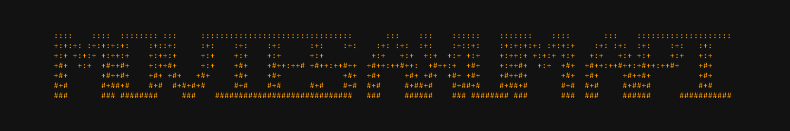
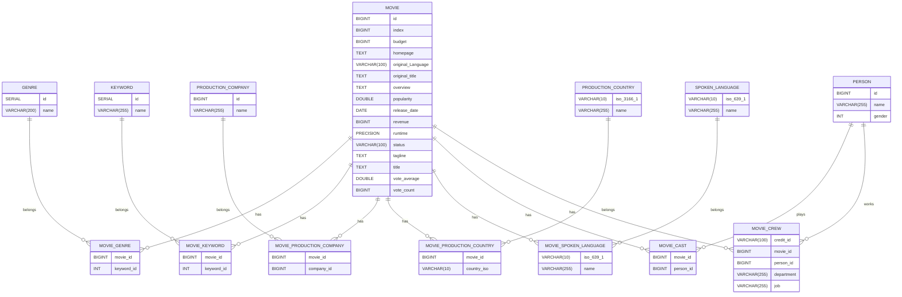
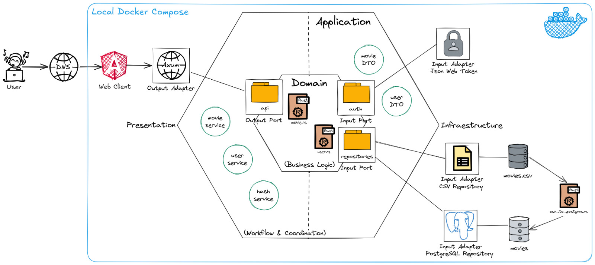

<p align="center">
    
</p>

<p align="center">
    
    
    
    
    
    
    
</p>

<p align="center">
    A RESTful movie catalogue API built with Rust, Axum and PostgreSQL, with JWT-protected write endpoints.
</p>

---

## Requirements

- **Docker** + **Docker Compose**

## Getting Started

1. Configure the environment (fill in `POSTGRES_*`, `DATABASE_URL` and `JWT_SECRET_KEY`):
   ```bash
   cp .env.example .env
   ```
2. Start PostgreSQL, the API and the frontend (migrations run automatically on startup):
   ```bash
   docker compose up --build
   ```
3. (Optional) seed the database from `db/movies.csv`:
   ```bash
   docker compose run --rm seed
   ```

> The frontend is served at `http://localhost:4000`.
> The API is served at `http://localhost:3000/api/v1`.
> Interactive Swagger docs live at `/api/v1/docs`.

## Endpoints

| Method | Path             | Auth      | Description                                  |
|--------|------------------|-----------|-----------------------------------------------|
| GET    | `/health`        | –         | Health check                                  |
| GET    | `/movies`        | –         | List movies, paginated and filterable (see below) |
| GET    | `/movies/{id}`   | –         | Get a movie by id                             |
| POST   | `/movies`        | Bearer    | Create a movie                                |
| PATCH  | `/movies/{id}`   | Bearer    | Update any field of a movie, relations included (see below) |
| DELETE | `/movies/{id}`   | Bearer    | Delete a movie                                |
| POST   | `/users/login`   | –         | Log in, returns a JWT                         |
| POST   | `/users/bootstrap` | –       | Register a user (requires matching `secret_key`) |
| GET    | `/analytics/overview` | – | Catalogue-wide totals and averages            |
| GET    | `/analytics/genres` | –       | Per-genre stats                               |
| GET    | `/analytics/years` | –        | Per-release-year stats                        |
| GET    | `/analytics/movies/top-grossing` | – | Highest-grossing movies                 |
| GET    | `/analytics/movies/most-profitable` | – | Most profitable movies, by profit or ROI |
| GET    | `/analytics/movies/top-rated` | – | Best-rated movies (Bayesian weighted rating) |
| GET    | `/analytics/directors` | –    | Director ranking                              |
| GET    | `/analytics/actors` | –       | Actor ranking                                 |
| GET    | `/analytics/companies` | –    | Production company ranking                    |
| GET    | `/analytics/countries` | –    | Production country ranking                    |
| GET    | `/analytics/budget-tiers` | – | Stats grouped by budget size                  |
| GET    | `/analytics/runtimes` | –     | Stats grouped by runtime                      |

All paths are prefixed with `/api/v1`. Protected routes expect `Authorization: Bearer <token>`, obtained from `/users/login`.

### Listing & filtering movies

`GET /movies` supports pagination and the following optional query filters, all combinable:

| Query param | Type   | Matches                                                        |
|-------------|--------|-----------------------------------------------------------------|
| `limit`     | number | Page size (default `10`)                                        |
| `offset`    | number | Page offset (default `0`)                                       |
| `genre`     | string | Movies tagged with the given genre (e.g. `Action`)               |
| `keyword`   | string | Movies with a keyword containing the text (case-insensitive)     |
| `language`  | string | Movies whose original language code matches exactly (e.g. `en`)  |
| `country`   | string | Movies with a production country matching the ISO code or name   |
| `search`    | string | Movies whose title or original title contains the text, anywhere, case-insensitive |

Example:

```
GET /api/v1/movies?genre=Action&language=en&search=venger&limit=20
```

### Updating movies

`PATCH /movies/{id}` only touches the fields present in the body. Scalar fields (`title`, `budget`, `release_date`, …) are overwritten; list fields (`genres`, `keywords`, `cast`, `production_companies`, `production_countries`, `spoken_languages`) **replace** the movie's current list. Send `"director": ""` to remove the director. Cast and director names not yet in the database are created on the fly. The whole update runs in a single transaction.

```json
PATCH /api/v1/movies/19995
{ "title": "Avatar (Remastered)", "genres": ["Action", "ScienceFiction"], "director": "James Cameron" }
```

The API listens on port `3000` by default; set `PORT` to change it.

### Analytics

All analytics endpoints are public and computed in SQL over the live catalogue, so they reflect every create, update and delete. ROI is `(revenue - budget) / budget`; `median_roi` and `profitable_share` only count movies with both a budget and revenue.

| Endpoint | Returns | Query params |
|----------|---------|--------------|
| `/analytics/overview` | Total movies, budget, revenue and votes; average budget, revenue, rating and runtime; median ROI; profitable share; earliest/latest release; genre, language, country and company counts | – |
| `/analytics/genres` | Per genre: movie count, average rating, runtime, budget and revenue, total revenue, median ROI | – |
| `/analytics/years` | Per year: movie count, total budget and revenue, average rating and runtime | `from`, `to` (year, inclusive) |
| `/analytics/movies/top-grossing` | Movies with budget, revenue, profit and ROI | `limit`, `genre` |
| `/analytics/movies/most-profitable` | Same shape as above | `limit`, `genre`, `sort_by` (`profit` \| `roi`, default `profit`), `min_budget` (default `1000000`) |
| `/analytics/movies/top-rated` | Movies with average rating, vote count and `weighted_rating` | `limit`, `genre`, `min_votes` (default `1000`) |
| `/analytics/directors`, `/actors`, `/companies`, `/countries` | Per entity: movie count, average rating, total budget and revenue, average revenue (countries also include `iso_3166_1`) | `limit`, `sort_by` (`movie_count` \| `rating` \| `revenue`, default `movie_count`), `min_movies` (default `3`) |
| `/analytics/budget-tiers` | Buckets from Micro (< $1M) to Blockbuster (≥ $100M): movie count, average rating, budget and revenue, median ROI, profitable share | – |
| `/analytics/runtimes` | Same as budget tiers, bucketed from Short (< 90 min) to Epic (≥ 180 min) | – |

`limit` defaults to `10` and is clamped to `1–100`. `genre` takes the same values as in `/movies` (e.g. `ScienceFiction`). `weighted_rating` is an IMDb-style Bayesian average that pulls movies with few votes towards the catalogue mean, so a handful of perfect votes can't beat a classic rated by thousands.

Example:

```
GET /api/v1/analytics/movies/most-profitable?sort_by=roi&genre=Horror&limit=5
```

## Frontend

The Angular app in `movies-api_front/` runs as the `frontend` service in Docker Compose (`http://localhost:4000`). For local development, run `npm install && npm start` inside `movies-api_front/` (served at `http://localhost:4200`). It has:

- **`/`**: catalogue with search and filters, plus a live analytics dashboard told as a six-chapter story; every chart carries a data-driven takeaway that updates with the selected metric.
- **`/gestion`**: admin console with the full CRUD (list, create, edit, delete) over `/movies`. Requires login.
- **`/sobre-nosotros`**: the team behind the project.
- **`/login`**: admin login and registration.

---

## Database Diagram



## Architecture Diagram

<p align="center">
    
</p>

---

## License

This project is licensed under the [MIT License](./LICENSE).

## Authors

* [Yenterick](https://github.com/Yenterick)
* [Faiderasp](https://github.com/Faiderasp)
* [TomasSalav](https://github.com/TomasSalav)
